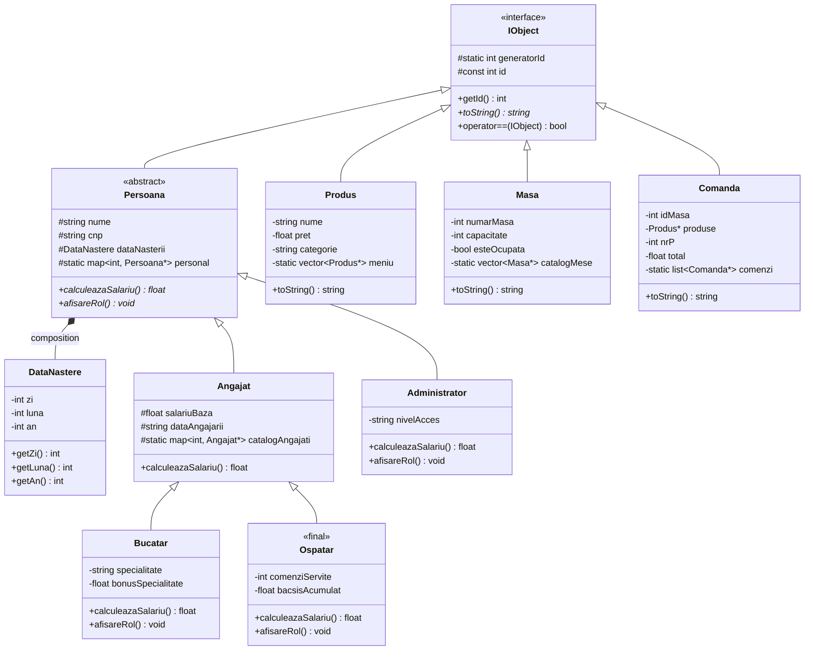

# Galmondo – Restaurant Management & POS System

[](https://en.cppreference.com/w/cpp/17)
[](#key-object-oriented-principles)
[-blueviolet?style=flat)](#design-patterns)
[](#standard-template-library-stl--modern-algorithms)
[](#license)

> **Enterprise-oriented C++ console application** designed to manage end-to-end restaurant hospitality operations: staff roles, interactive dynamic menus, table occupancy, live order billing, customer feedback processing, and thread-safe audit logging.
> 
> *Developed by **Ania Pricop** as part of the Object-Oriented Programming (OOP) curriculum.*

---

## Table of Contents

1. [Project Overview](#project-overview)
2. [Key Architecture & OOP Principles](#key-architecture--oop-principles)
3. [Design Patterns](#design-patterns)
4. [Generic Programming & Templates](#generic-programming--templates)
5. [Standard Template Library (STL) & Modern Algorithms](#standard-template-library-stl--modern-algorithms)
6. [Robust Custom Exception Hierarchy](#robust-custom-exception-hierarchy)
7. [System Architecture Diagram](#system-architecture-diagram)
8. [Interactive CLI Navigation](#interactive-cli-navigation)
9. [Build & Execution Guide](#build--execution-guide)
10. [Memory Management & RAII](#memory-management--raii)
11. [Author & Contact](#author--contact)

---

## Project Overview

**Galmondo** is a comprehensive restaurant management and Point-of-Sale (POS) backend system written in modern **C++17**. The project emphasizes clean software engineering principles, modular architecture, complete exception safety, and advanced C++ language capabilities.

### Key Functional Modules

- **Staff & HR Management:** Multi-tiered personnel administration with polymorphic salary computing, role filtering, and dynamic bonus attribution.
- **Dynamic Menu Catalog:** Full CRUD operations for dishes and beverages, price sorting, name-based lookup, and category filtering.
- **Table Reservation & Seating:** Table management with capacity bounds checking, occupancy tracking, and real-time availability.
- **Order Lifecycle & Billing:** Dynamic order creation, product aggregation, automatic tax (VAT) computation, and total calculation.
- **Customer Feedback Engine:** Dual-channel feedback subsystem (numeric ratings and text reviews) with memory bounds, conversion adapters, and specialized reporting.
- **Centralized System Audit:** Event logging for every critical operation and exception catch block via a Meyers' Singleton.
- **Fast-Service Meal Combos:** Extensible quick-order meal generation using the Abstract Factory pattern with Dependency Injection.

---

## Key Architecture & OOP Principles

The codebase is built from the ground up demonstrating all foundational and advanced Object-Oriented Programming pillars:

### 1. Root Interface Contract (`IObject`)
All domain entities (`Persoana`, `Produs`, `Masa`, `Comanda`, etc.) derive from an abstract base class `IObject`:
- **Identity Tracking:** Thread-safe unique auto-incrementing ID generator (`static int generatorId`).
- **Polymorphic String Representation:** Enforces `virtual std::string toString() const = 0` across all derived classes.
- **Operator Overloading:** Universal equality comparison (`operator==`) and polymorphic stream output (`operator<<`) that delegates dynamically to `toString()`.

### 2. Multi-Level Inheritance (`is-a`) & Composition (`has-a`)
- **3-Tier Inheritance Tree:** `IObject` $\rightarrow$ `Persoana` (abstract) $\rightarrow$ `Angajat` $\rightarrow$ `Bucatar` (Chef) / `Ospatar` (Waiter).
- **Class Extension Prevention:** `Ospatar` is explicitly declared `final` to prohibit unintended inheritance.
- **Composition:** `Persoana` encapsulates a `DataNastere` (Date of Birth) value object, illustrating strong composition and lifecycle coupling.

### 3. Pure Virtual Interfaces & Dynamic Polymorphism
- `Persoana` defines pure virtual methods:
  - `virtual float calculeazaSalariu() const = 0;`
  - `virtual void afisareRol() const = 0;`
- Subclasses implement specific business rules: Chefs receive culinary specialty bonuses, Waiters track accumulated tips and served orders, and Administrators maintain access privileges.

### 4. Safe Downcasting & RTTI
- Utilizes `dynamic_cast` within personnel management to query runtime types safely (e.g., granting bonuses exclusively to `Bucatar` instances without risking undefined behavior).
- Integrates `<typeinfo>` and `typeid` for introspecting concrete types during personnel auditing.

### 5. Encapsulation & Data Invariants
- Internal states are protected by strict access specifiers (`private` for invariants, `protected` for inheritance).
- Robust setters validate boundaries (e.g., date ranges, positive salaries, capacity limits) and trigger domain-specific exceptions upon invalid input.

---

## Design Patterns

### 1. Meyers' Singleton Pattern (`Logger`)
Implemented in the `Logger` class for thread-safe, centralized activity and audit recording:
- **Lazy Initialization:** `getInstance()` creates the single instance on first use via a function-local static variable.
- **Copy & Assignment Deletion:** `Logger(const Logger&) = delete;` and `Logger& operator=(const Logger&) = delete;` ensure singularity.
- **Subsystem Integration:** Seamlessly records all CRUD operations, state transitions, and caught exceptions across the entire program.

```cpp
class Logger {
private:
    std::vector<std::string> istoricActiuni;
    Logger() { istoricActiuni.push_back("[System] Logger initialized."); }
public:
    static Logger& getInstance() {
        static Logger instance;
        return instance;
    }
    Logger(const Logger&) = delete;
    Logger& operator=(const Logger&) = delete;
    void log(const std::string& action);
    void afiseazaJurnal() const;
};
```

### 2. Abstract Factory Pattern (`IFabricaMeniu`)
Provides an extensible framework to produce families of related meal items without tying client code to concrete implementations:
- **Abstract Products:** `IFelPrincipal` (Main Course) and `IBautura` (Drink).
- **Concrete Product Families:**
  - Standard Family: `BurgerClasic` + `Milkshake`
  - Vegan Family: `BurgerVegan` + `Limonada`
- **Abstract Factory:** `IFabricaMeniu` declaring `creeazaFelPrincipal()` and `creeazaBautura()`.
- **Concrete Factories:** `FabricaStandard` and `FabricaVegan`.
- **Dependency Injection:** The consumer function `servesteClient(IFabricaMeniu& factory)` relies strictly on interfaces, allowing product families to be swapped seamlessly at runtime.

---

## Generic Programming & Templates

### 1. Class Template with Non-Type Parameter (`RegistruFeedback<T, int LimitaMemorie>`)
A bounded-capacity feedback storage container managing ratings or reviews:
- **Non-Type Parameter:** `LimitaMemorie` defines the strict maximum capacity at compile time.
- **Overflow Protection:** Automatically throws `std::overflow_error` if entries exceed capacity.
- **Member Template Function:** `adaugaFeedbackConvertit<U>(valoare, functieConversie)` accepts arbitrary input types `U` and converts them to `T` via a custom functional converter.

```cpp
// Instantiations in Galmondo:
RegistruFeedback<std::string, 50> reviewsText;  // Textual reviews (max 50)
RegistruFeedback<int, 100> starRatings;         // Numerical scores 1-5 (max 100)
```

### 2. Function Templates & Full Specialization
- **Generic Status Function:** `afiseazaStatusRegistru<T, N>()` inspects and reports current load vs. capacity for any feedback register.
- **Template Function `genereazaRaport<T>()` with Total Specializations:**
  - `genereazaRaport<int>`: Calculates aggregate statistical averages (mean star rating).
  - `genereazaRaport<std::string>`: Formats and outputs an enumerated list of customer comments and suggestions.

---

## Standard Template Library (STL) & Modern Algorithms

The project purposefully pairs data requirements with optimal STL containers and modern lambda algorithms:

| Container | Chosen For | Subsystem Usage | Complexity |
| :--- | :--- | :--- | :--- |
| `std::vector<T>` | Contiguous memory, cache locality, $O(1)$ random access | `Logger` audit trail, `RegistruFeedback`, Menu storage | $O(1)$ amortized append / access |
| `std::list<T>` | Fast insertion/deletion without array reallocation | Active live orders queue | $O(1)$ insert/erase |
| `std::map<Key, Value>` | Ordered associative storage, balanced BST lookup | Employee catalog (`id` $\rightarrow$ `Angajat*`), Person registry | $O(\log N)$ search / insert / delete |

### STL Algorithms & C++11/14/17 Lambdas
- `std::find_if`: Fast lookup of menu items by name using custom predicate lambdas.
- `std::sort`: Dynamic sorting of products based on pricing criteria.
- `std::count_if`: Real-time querying of active, pending, or completed orders.
- `std::remove_if` + `erase`: Erase-remove idiom for safe, efficient removal of items from catalogs.
- `std::for_each`: Clean declarative traversal for reports and listings.

---

## Robust Custom Exception Hierarchy

Galmondo implements a defensive exception handling system where every custom exception derives from `RestaurantException` (which extends `std::exception`), guaranteeing strong exception safety and safe stack unwinding.

```
std::exception
  └── RestaurantException (base, provides `what() noexcept override`)
        ├── CapacitateMasaException   (table overbooking / overflow)
        ├── ProdusInexistentException  (missing menu item lookup)
        ├── DateInvalideException      (negative values, invalid date/salary)
        └── PersoanaNegasitaException  (employee search failures)
```

### Exception Guarantees:
- **`noexcept override` Destructors:** Enforces safe unwinding during runtime exceptions.
- **Hierarchical Catch Blocks:** Specialized derived exceptions are caught first, followed by base `RestaurantException`, generic `std::exception`, and an ellipses fallback (`catch(...)`) to ensure the interactive console never crashes unexpectedly.

---

## System Architecture Diagram



---

## Interactive CLI Navigation

The application provides a comprehensive text-driven dashboard:

```text
==================================================
        GALMONDO RESTAURANT MANAGEMENT SYSTEM     
==================================================
1. Staff Management     - Employee CRUD, filtering, sorting, bonuses
2. Menu Management      - Dish/drink CRUD, price sorting, search
3. Table Management     - Seating capacity, reservation status
4. Order Management     - Create, view, update, close live orders
5. Customer Feedback    - Text reviews, 1-5 star ratings, reports
6. System Audit Log     - Meyers' Singleton audit trail inspection
7. Quick Service (POS)  - Abstract Factory meal combos (Standard / Vegan)
0. Exit System
==================================================
```

---

## Build & Execution Guide

### Prerequisites
- A modern C++ compiler supporting **C++17** (`g++` $\ge 8.0$ or `clang++` $\ge 6.0$).
- `make` (optional, for automated builds).

### Using `make` (macOS / Linux)

```bash
# Build the application
make

# Run the executable
make run

# Clean build artifacts
make clean
```

### Manual Compilation

#### macOS / Linux
```bash
g++ -std=c++17 -Wall -Wextra -O2 restaurant.cpp -o restaurant
./restaurant
```

#### Windows (MinGW / PowerShell)
```powershell
g++ -std=c++17 -Wall -Wextra -O2 restaurant.cpp -o restaurant.exe
.\restaurant.exe
```

---

## Memory Management & RAII

- **Polymorphic Virtual Destructors:** Implemented on all base classes (`IObject`, `Persoana`, `Angajat`, `RestaurantException`) to ensure proper cleanup and avoid object slicing.
- **Deterministic Resource Cleanup:** Static container registries explicitly release all dynamically allocated heap objects on exit:
  - `Produs::curataMeniu()`
  - `Angajat::curataCatalog()`
  - `Masa::curataCatalog()`
  - `Comanda::curataComenzi()`
  - `Persoana::curataPersonal()`
- **Rule of Three / Five:** Copy constructors, assignment operators, and destructors are implemented where dynamic memory allocation is managed manually.

---

## Author & Contact

- **Author:** Ania Pricop
- **Course:** Object-Oriented Programming (OOP)
- **Institution:** Faculty of Mathematics and Computer Science
- **Language:** C++17

---

## License

This project is licensed under the [MIT License](LICENSE) – feel free to use it for learning and portfolio reference.
